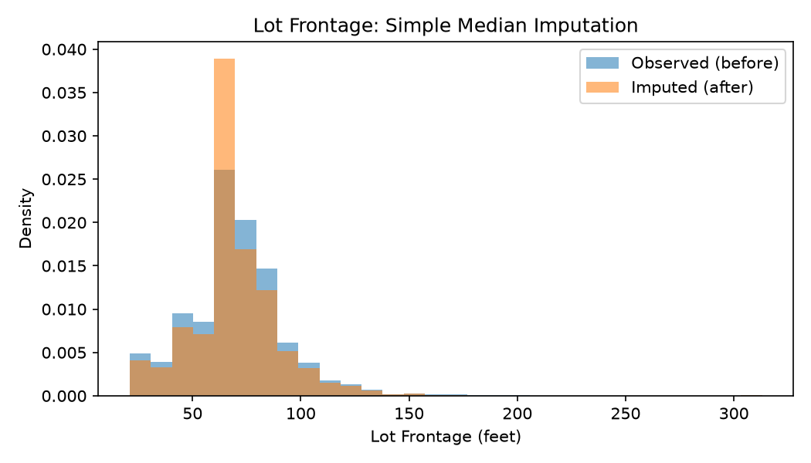
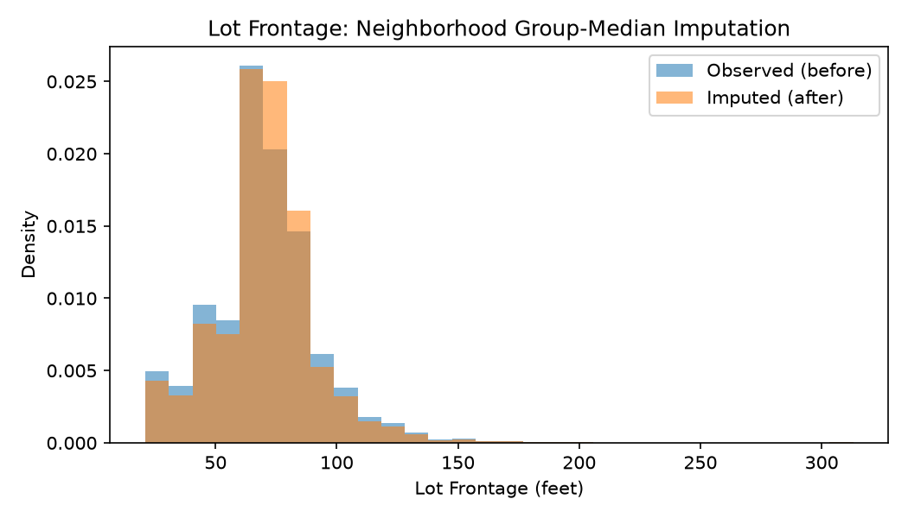

# HW5 report

## 1 Provenance
I downloaded the Ames Housing dataset (De Cock, 2011) on 2026-11-23 from `https://jse.amstat.org/v19n3/decock/AmesHousing.txt` using `src/download.py`, which checks if the file already exists so it never overwrites the raw copy. On arrival, the file has 2,930 rows and 82 columns. The full citation, dictionary link, and terms of use are in `README.md`.

## 2 Validation: failures on the raw file
Running `src/validate.py` on the raw file flagged five issues. Instead of silently patching them, I logged each one and fixed them in `src/clean.py` to build `data/processed/ames_clean.csv`, which passes `make validate`.

| Rule type | Column(s) | Failure count | What was wrong in raw | Fix in `src/clean.py` |
| --- | --- | ---: | --- | --- |
| Range (study period) | `Garage Yr Blt` | 1 | `2207` is way past the 2010 study cutoff | Set to `NaN` since I can't verify the true year |
| Allowed values (dictionary) | `MS Zoning` | 29 | `C (all)` (25), `I (all)` (2), `A (agr)` (2) don't match dictionary codes | Mapped to `C`, `I`, and `A` |
| Allowed values (dictionary) | `Bldg Type` | 272 | `Duplex` (109), `Twnhs` (101), `2fmCon` (62) don't match dictionary codes | Mapped to `Duplx`, `TwnhsI`, and `2FmCon` |
| Cross-column | `Year Remod/Add`, `Year Built` | 1 | Remodel year was earlier than build year | Set `Year Remod/Add = Year Built` |
| Cross-column | `Year Built`, `Yr Sold` | 1 | Build year was after sale year (pre-construction sale) | Capped `Year Built` at `Yr Sold` |

## 3 Sentinels and structural absence
Comparing a default `pd.read_csv` load against `keep_default_na=False` showed 14 columns that contain the literal string `"NA"`. Checking the data dictionary confirmed that in every single one of those 14 columns, `"NA"` means the house simply doesn't have that feature—not that the value is unknown.

| Columns with literal `"NA"` | Dictionary meaning | How I handled it |
| --- | --- | --- |
| `Alley`, `Bsmt Qual`, `Bsmt Cond`, `Bsmt Exposure`, `BsmtFin Type 1`, `BsmtFin Type 2`, `Fireplace Qu`, `Garage Type`, `Garage Finish`, `Garage Qual`, `Garage Cond`, `Pool QC`, `Fence`, `Misc Feature` (14 columns) | Structural absence (no alley, basement, fireplace, garage, pool, fence, or misc feature) | Stored as `"Absent"` so pandas doesn't coerce it to `NaN`; only actual blanks become `NaN` |

- **The `"None"` string issue:** `Mas Vnr Type` has 1,752 rows with the literal string `"None"`. Default `pd.read_csv` wiped all 1,752 of them into `NaN`, giving 1,775 `NaN`s when there are really only 23 missing values. The dictionary defines `"None"` as no masonry veneer, so I recoded it to `"NoVeneer"` and left only the 23 blanks as `NaN`.
- **Numeric zeros:** Columns like `Pool Area`, `Garage Area`, `Garage Cars`, `Total Bsmt SF`, `Mas Vnr Area`, `2nd Flr SF`, `Wood Deck SF`, `Open Porch SF`, `Fireplaces`, and `Misc Val` use `0` when a house doesn't have that feature. These are true zeros, not sentinels—a house without a pool literally has 0 sq ft of pool area, so keeping `0` makes physical sense.

## 4 Keys and duplicates
- **Choosing a key:** Both `Order` (observation index) and `PID` (parcel ID) are 100% unique across all 2,930 rows, with 0 exact duplicate rows, 0 `Order` duplicates, and 0 `PID` duplicates. I chose `Order` as the sale key because it identifies an individual sale record, whereas `PID` identifies the physical lot (which could show up twice if a house sold more than once).
- **Lookup join:** I built a 28-row `Neighborhood` lookup table with the full names from the dictionary and merged it using `pd.merge(..., validate="many_to_one")`. The row count stayed at 2,930 with 0 unmatched neighborhoods.

## 5 Missingness mechanism
- **`Lot Frontage` (490 / 2,930 missing, 16.72%):** Rows missing `Lot Frontage` look noticeably different from rows that have it. They sit on bigger lots (mean `Lot Area` 12,331 vs 9,710 sq ft), sell for slightly more ($184,263 vs $180,100), have slightly more living area (1,553 vs 1,489 sq ft), and are way more likely to be on a cul-de-sac (`CulDSac` makes up 18.0% of missing rows vs 3.8% of present rows, while `Inside` drops from 76.5% to 55.9%). Neighborhoods like `Gilbert` and `Sawyer` also show up more often among the missing rows. That's enough to reject MCAR and lean toward **MAR**, tied to lot layout and neighborhood.
- **`Mas Vnr Area` (23 / 2,930 missing, 0.78%):** The 23 missing rows are much newer (mean `Year Built` 2002.7 vs 1971.1), more expensive ($233,349 vs $180,380), and heavily clustered in `Somerst` (43.5%) and `Gilbert` (21.7%). Again, this rejects MCAR and points to **MAR**, likely just incomplete data entry for newer developments.
- **What the data can't tell us:** Comparing observed columns can rule out MCAR, but it can never prove MAR over MNAR because we don't have the missing values to check.
- **If `Lot Frontage` were MNAR:** Assessors might skip recording frontage specifically on odd-shaped or flag lots where the actual street frontage is unusually narrow or awkward to measure, meaning the missingness depends directly on the unseen frontage value itself.

## 6 Imputation strategy and defense (at most 150 words)

| Strategy | Std before | Std after | Corr(`Lot Area`) before | Corr(`Lot Area`) after |
| --- | ---: | ---: | ---: | ---: |
| Simple Median | 23.3653 | 21.3264 | 0.4913 | 0.3628 |
| Neighborhood Group-Median | 23.3653 | 21.7185 | 0.4913 | 0.3891 |

**Defense:** I'm going with **Neighborhood group-median imputation**. In Part 5, I rejected MCAR for `Lot Frontage` and argued for MAR because missingness is heavily tied to neighborhood and lot configuration. Filling everything with one global median ignores that pattern, creates an artificial spike at a single number, shrinks the standard deviation more (23.37 down to 21.33), and weakens the correlation with `Lot Area` (0.49 down to 0.36). Grouping by `Neighborhood` uses an observed variable that actually tracks both lot size and missingness, so it does a better job preserving the spread (21.72) and the relationship with `Lot Area` (0.39).

## 7 Leakage-safe evaluation
Using 5-fold CV (`random_state=5110`) with `LinearRegression` on `log(SalePrice)` and the 10 `NUMERIC_FEATURES` from `README.md`:

| Variant | Fill method | 5-fold CV RMSE |
| --- | --- | ---: |
| A | Median `Lot Frontage` within `SalePrice` quintiles on the full table | 0.159467 |
| B | Neighborhood group-median fitted on the full table before CV | 0.159523 |
| C | Neighborhood group-median inside a `Pipeline` (`NeighborhoodMedianImputer`) | 0.159540 |

- **Which is right and which leaks:** Variant **C** is the only valid score because the medians are fit strictly inside each training fold. Variant **A** has direct target leakage since it uses `SalePrice` to impute a feature. Variant **B** leaks validation-fold `Lot Frontage` values into the training medians by computing them on the full table before splitting.
- **Unusable for unsold homes:** Variant **A** can't price a house that hasn't sold yet because you'd need to know its `SalePrice` just to put it in a quintile and fill in `Lot Frontage`.
- **Why B vs C is so close:** The difference is tiny (`+0.000017` log-RMSE) because neighborhood medians barely budge across 80/20 folds, and `Lot Frontage` has a relatively small weight in a 10-feature linear model dominated by `Overall Qual` and `Gr Liv Area`.

## 8 What this data cannot tell you
Even after cleaning and auditing, this dataset can't prove whether `Lot Frontage` or `Mas Vnr Area` are truly MAR versus MNAR, can't confirm if `Garage Yr Blt = 2207` was actually supposed to be `2007`, and doesn't tell us how prices behave outside Ames, Iowa or after 2010.
